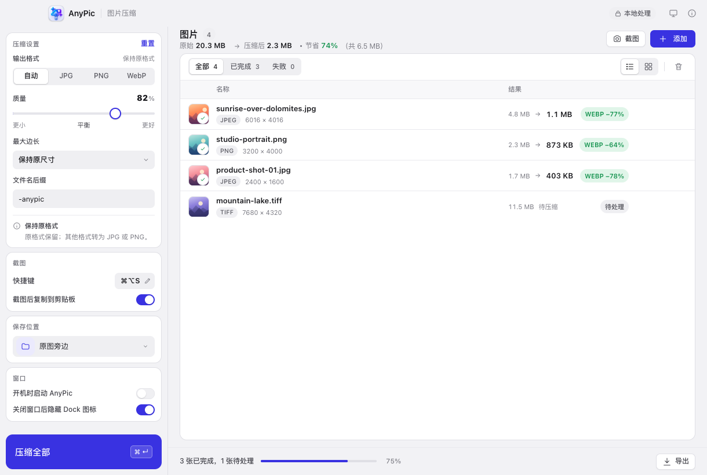

# AnyPic · Lighter, still stunning

[中文](README.md) · English

AnyPic is a cross-platform image-compression desktop app built with [MyGo](https://github.com/egoist/mygo). Its interface is modeled on clean desktop tools: white cards with hairline borders on a neutral canvas, gray pill-shaped controls, segmented switches with white thumbs, hairline dividers, and a sparing indigo accent. Settings live in the sidebar, and actions sit next to the content. Every image is processed locally.

The interface follows the system language (English when Chinese is not available) and ships in Simplified Chinese and English; Preferences → Appearance → Language pins either one.

Website and 40-second intro video: <https://kidultx.github.io/AnyPic/>



## Download

| Platform | Installer |
| --- | --- |
| macOS (universal: Intel / Apple Silicon) | `AnyPic <version>.dmg` |
| Windows 10/11 | `AnyPic Setup <version> amd64.exe` |
| Linux | `anypic_<version>_amd64.deb` or `anypic-<version>-linux-amd64.tar.gz` |

Download the installer for your platform from the [Releases](../../releases) page. Installers are built automatically by GitHub Actions whenever a release tag is pushed (see “Release & CI” below). After installation, About AnyPic → Check for Updates (「关于 AnyPic → 检查更新」) lets you check for a new version from inside the app and download and install it: on Windows and macOS AnyPic asks you to quit before it opens the installer, and on Linux it reveals the downloaded file.

> macOS: the installer is not notarized by Apple. If Gatekeeper blocks the first launch, go to System Settings → Privacy & Security and click “Open Anyway”. Linux requires system WebKitGTK (`libwebkit2gtk-4.1`) to run; Windows requires WebView2 (usually preinstalled on Windows 10/11).

## Features

- **Batch processing**: drag in files or whole folders, or use the system picker to add up to 500 images at once.
- **Open With**: AnyPic registers as an image handler — choose AnyPic from Open With in Finder / Explorer, drag an image onto the Dock / taskbar icon, or pass a path on the command line, and it goes straight into the queue (on Windows / Linux, later launches hand the file to the already-running instance).
- **Queue batch actions**: select several images or all of them and remove the selection in one click (undoable), and filter the queue by filename. The queue also behaves like a real list: ↑/↓ move, Shift+↑/↓ or Shift+click select a range, ⌘/Ctrl+A selects the visible rows, Delete/Backspace removes the selection (⌘⌫ still clears the queue), and Space or Enter opens the preview. Right-click any row for preview, beautify, export, Show in Folder, or remove — the same in list and grid view.
- **Paste to queue**: copy an image in another app and press ⌘V / Ctrl+V to add it to the queue; pasted images are saved to `Pictures/AnyPic`, alongside screenshots.
- **Hotkey screenshots**: the default is ⌘⌥S (Ctrl+Alt+S on Windows / Linux); click the shortcut in Preferences (⌘, or the sidebar's footer) to record a new combination. Capture a region of the screen at any time — the screenshot is saved to `Pictures/AnyPic` and added to the queue, and you can choose whether to copy it to the clipboard as well. On macOS the image is taken through a temporary file rather than the clipboard, so the paste-permission prompt does not keep coming back.
- **Beautify in preview**: the preview has two tabs, Compare / Beautify (「对比 / 美化」). The beautify workspace offers six groups of controls — background (solid colors, gradient presets, 15 code-drawn day-card patterns and a custom color picker), corner radius, hairline border, shadow, padding, and canvas ratio (1:1 / 4:3 / 16:9, which only extends the canvas and never crops). Adjustments are reflected in the large preview in real time; when you are happy with them, apply in one click — this creates the file `<name>-美化.png` next to the original without touching it, then compresses and exports as usual. Beautifying happens entirely on your machine; the pattern backdrops are drawn in code, with no network fetch.
- **Lives in the tray**: after you close the window, AnyPic stays in the menu bar / notification area and the screenshot hotkey keeps working; Preferences lets you choose whether to hide the Dock icon while the window is closed (hidden by default). The menu bar icon can reopen the window or quit. Only one AnyPic runs at a time: starting it again while it is already running brings the existing window back to the front instead of opening a second copy.
- **Launch at login**: Preferences has a Launch AnyPic at login (「开机时启动 AnyPic」) toggle that writes to the system's login items (Login Items on macOS / XDG autostart on Linux / the Run registry key on Windows); the toggle stays in sync with the actual system state.
- **Smart compression**: JPG/PNG/WebP keep their format; GIF/BMP/TIFF are converted to the more widely supported JPG or PNG; transparent images are never silently flattened onto black or white.
- **Animated images to WebP**: animated GIF / WebP become animated WebP with frame count, timing, looping and transparency preserved — never just the first frame; if transcoding makes the file bigger, the original is kept and labeled “Already optimal” (「已是最优」). Beautify (borders, backgrounds, etc.) does not support animated images yet.
- **Output formats**: Auto (「自动」), or JPG / PNG / WebP, with a quality slider covering 30–100; when JPG is selected, images with transparency are saved as PNG instead of being flattened onto a background.
- **Resize on demand**: limit the long edge to 3840, 2560, 1920, 1280 or 800 pixels, using Lanczos resampling.
- **Honest processing that never sacrifices clarity**: if re-encoding would make the file bigger, the original is used as-is and labeled “Already optimal”.
- **Retry failures**: failed images can be retried in one click; completed images are not re-encoded.
- **Before / after**: drag a divider in the app to inspect the difference in detail before and after compression. Scroll or pinch to zoom and drag to pan (the two images move together), switch between “Fit” and “100%” with the current ratio shown, and use ←/→ to step through the queue.
- **Flexible saving**: save next to the original or to a folder you choose, with a custom filename suffix and batch export.
- **Chinese and English**: the interface follows the system language (English when Chinese is not available) and can be pinned to either under Preferences → Appearance → Language; the sidebar, menus, dialogs, error messages and aria labels switch together. The copy lives in on-device catalogs under `locales/`, so a new language needs no UI code changes.
- **A clean desktop interface**: a neutral background, white cards with hairline borders and clear tables, with a hideable title bar, native menus, keyboard shortcuts, drag and drop, light / dark themes, and window-state memory.
- **Privacy first**: no image uploads, no accounts, no telemetry; image processing happens entirely on your machine. The app's only network activity is checking for updates and downloading installers (only when you act, and only from GitHub Releases). Temporary files are cleaned up when the app quits (unsaved compression results are lost).

## Tech stack

| Layer | Implementation |
| --- | --- |
| Desktop framework | MyGo 0.6.4 (Go + system WebView, typed IPC) |
| Frontend | Vanilla TypeScript + Vite, no UI framework |
| Decoding / resizing | `disintegration/imaging`, Go standard library |
| JPEG / PNG | Go standard library |
| WebP | `gen2brain/webp` (pure Go, embeds libwebp) |
| BMP / TIFF | `golang.org/x/image` |

MyGo handles the window, menus, file dialogs, file drag and drop, and the Go ↔ TypeScript event bridge; the `AnyPic` service in `compressor.go` owns the queue, compression, thumbnails, previews and export.

## Development

Requires **Go 1.27.3+** and **Bun**:

```bash
bun install
bun run dev          # start the MyGo desktop dev environment
```

To preview just the frontend (opens in a browser in demo mode with sample data):

```bash
bun run dev:web
```

## Verification & packaging

```bash
bun run typecheck    # TypeScript type check
go vet ./...
go test -race ./...  # backend unit and integration tests
bun run build        # build the app bundle and installers under build/
```

`bun run build` automatically unlocks the local signing keychain (`~/Library/Keychains/anypic-signing.keychain-db`, password `anypic-local`) and signs with the self-signed certificate “AnyPic Local Signing” stored there. The certificate identity is fixed, so the macOS screen-recording permission stays valid across rebuilds. CI builds no longer always sign ad hoc: release builds use the fixed release certificate described under “Release & CI”, and only smoke builds or manual branch builds without the secrets fall back to ad-hoc signing.

Cross-platform packaging (MyGo does not depend on cgo, so you can cross-build on macOS):

```bash
bunx mygo build -platform linux/amd64,windows/amd64
```

> Linux requires system WebKitGTK and Windows requires WebView2 (usually preinstalled on Windows 10/11); MyGo itself does not depend on cgo.

## Release & CI

The repository ships three GitHub Actions workflows:

- **`.github/workflows/ci.yml`**: on every push to `main` and on every pull request, runs `tsc`, `go vet`, `go test -race`, and a darwin/amd64 build smoke test.
- **`.github/workflows/release.yml`**: when a `v*` tag is pushed (or the workflow is run manually from the Actions page), builds `darwin/universal`, `linux/amd64` and `windows/amd64` on a three-OS build matrix and uploads the artifacts; tag builds also collect all artifacts into a draft GitHub Release with generated release notes — review and publish it.
- **`.github/workflows/pages.yml`**: when `site/` changes are pushed to `main` (or the workflow is run manually from the Actions page), publishes `site/` as-is to GitHub Pages (<https://kidultx.github.io/AnyPic/>). The site has no build step; to change the intro video, edit the storyboard in `site/video/src/index.html` and re-render following the instructions at the top of `site/video/render.mjs`.

To release a new version:

```bash
# 1. update version in mygo.config.ts
# 2. commit and tag
git tag v0.1.1
git push origin main v0.1.1
# 3. wait for Actions to finish, then publish the draft in Releases
```

macOS release packages are signed with the fixed self-signed certificate “AnyPic Release Signing”, so their designated requirement stays `com.anypic.desktop` plus the certificate hash across versions and upgrades keep the Screen Recording permission. The certificate lives in two repository secrets, `MACOS_SIGNING_P12` (the p12 in base64) and `MACOS_SIGNING_PASSWORD`; `.github/workflows/release.yml` imports them into a temporary keychain before the macOS build and runs `.github/scripts/macos-verify-release.sh` afterwards to check the signatures of the `.app` and the DMG. The public certificate at `.github/macos-signing-cert.pem` is the expected signing identity, and CI verifies that the imported certificate matches it. Tag builds fail outright when the secrets are missing and never silently publish an ad-hoc build; manual `workflow_dispatch` runs fall back to ad-hoc with a warning. Replacing the certificate changes the designated requirement, so every Mac user must grant Screen Recording again: that is a breaking change. For notarized distribution, configure an Apple Developer certificate and `macos.notarize` for the repository.

The interface is organized around a flat set of design tokens (the UI language takes its cues from [magpie](https://github.com/yetone/magpie)) and has been statically audited with the app-scope rules of [Hallmark](https://github.com/Nutlope/hallmark), checking color tokens, contrast, focus and disabled states, overflow and ARIA. Hallmark is involved only in design review and does not ship in the build output.

## Supported formats & limits

- Input: JPG/JPEG, PNG, WebP, GIF (including animated), BMP, TIFF/TIF.
- Output: JPG, PNG, WebP (when JPG is selected, images with transparency are saved as PNG instead of being flattened onto a background); animated GIF / WebP are output as animated WebP.
- Up to 250 MB per file and 500 images per batch.
- HEIC and AVIF are not supported yet.
- PNG output is a lossless re-encode, so the quality slider has no effect; this is a limitation of the PNG format itself.
- Re-encoding removes metadata such as EXIF / XMP (including capture information and orientation tags); orientation is corrected automatically before processing.
- Before capturing on macOS, AnyPic checks the Screen & System Audio Recording permission (Screen Recording on older macOS). Without it AnyPic does not run the capture; it explains how to allow AnyPic in System Settings → Privacy & Security → Screen & System Audio Recording (if AnyPic is already switched on but this message still appears, select it and click “−” to remove it, then try again and allow it; quit and reopen AnyPic afterwards). The “Can't capture? Check screen recording permission” button in Preferences → Screenshots (「无法截图？检查屏幕录制权限」) opens that setting directly. Release builds are signed with a fixed self-signed certificate, so the permission survives upgrades; when upgrading from 0.1.7 or earlier, allow it once more when AnyPic asks. When building from source, configure the fixed signing identity described under “Verification & packaging” above, otherwise you have to re-authorize after every rebuild; for public distribution, switch to a Developer ID certificate and notarize. Linux needs one of gnome-screenshot, spectacle, or grim + slurp + wl-copy.

## Project structure

```text
main.go            app entry point, window, native menus, tray and command events
compressor.go      image queue, compression pipeline, previews, export, settings persistence
animation.go       animated-image frame counting: walks the file structure without decoding pixels
screenshot.go      hotkey screenshots, clipboard image capture and screenshot archiving
decorate.go        screenshot beautification: corner radius, border, shadow and background
patterns.go        backdrop patterns: the 15 code-drawn day-card fills
updater.go         in-app updates: check for new versions, download installers, quit and open them when installing
compressor_test.go backend tests
screenshot_test.go screenshot and settings-normalization tests
i18n.go            language resolution, the Go-side tr() and the stable error codes the page matches
locales/           Chinese and English message catalogs (zh-Hans.json / en.json) and the generated Go accessors
index.html         app UI markup
src/main.ts        state management, rendering and interaction
src/i18n.ts        page language choice, data-i18n markup filling and error codes
src/locales.ts     typed message accessors generated from locales/*.json
src/style.css      design system and responsive layout
src/mygo.ts        MyGo-generated type-safe IPC client
mygo.config.ts     app name, identifier, version and build config
.github/workflows  CI and release workflows
docs/              UI screenshots
site/              static website (GitHub Pages), no build step
site/video/        rendered intro video, plus its storyboard (src/) and render script (render.mjs)
```

## Open-source credits

- [MyGo](https://github.com/egoist/mygo) — MIT
- [disintegration/imaging](https://github.com/disintegration/imaging) — MIT
- [gen2brain/webp](https://github.com/gen2brain/webp) — BSD-3-Clause, includes [libwebp](https://chromium.googlesource.com/webm/libwebp) (BSD-3-Clause)
- [golang.org/x/image](https://pkg.go.dev/golang.org/x/image) — BSD-3-Clause
- [magpie](https://github.com/yetone/magpie) — UI language reference (its code is not included)

AnyPic's interface and implementation are original to this project and released under the [MIT](LICENSE) license.
