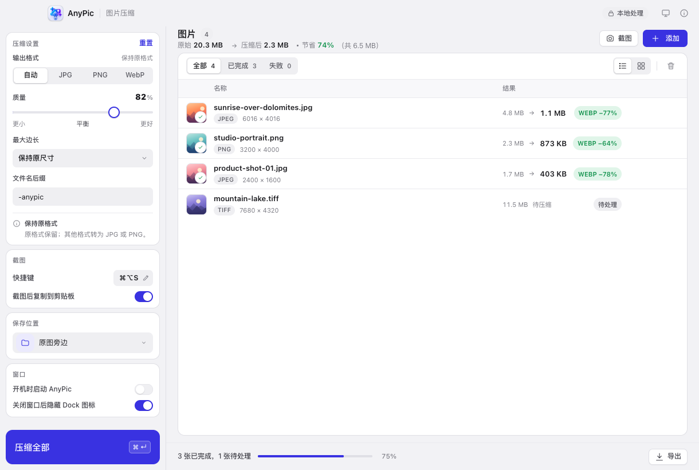

# AnyPic · 轻一点，依然惊艳

中文 · [English](README.en.md)

AnyPic 是一款使用 [MyGo](https://github.com/egoist/mygo) 构建的跨平台图片压缩桌面应用。界面取法简洁的桌面工具：中性画布上排布白色细边卡片，灰色药丸式控件、白色滑块的分段开关、发丝级分隔线与克制的靛蓝主色，设置收在侧栏，操作贴近内容。所有图片都只在本机处理。

官网与 40 秒介绍视频：<https://kidultx.github.io/AnyPic/>



## 下载

| 平台 | 安装包 |
| --- | --- |
| macOS（Intel / Apple Silicon 通用） | `AnyPic <版本>.dmg` |
| Windows 10/11 | `AnyPic Setup <版本> amd64.exe` |
| Linux | `anypic_<版本>_amd64.deb` 或 `anypic-<版本>-linux-amd64.tar.gz` |

到 [Releases](../../releases) 页面下载对应平台的安装包。安装包由 GitHub Actions 在每次发布 tag 时自动构建（见下文「发布」）。装好之后，「关于 AnyPic → 检查更新」可以在应用内检查新版本并下载安装：Windows 和 macOS 会先确认并退出 AnyPic 再打开安装包，Linux 则定位到下载的文件。

> macOS：安装包未经过 Apple 公证，首次打开如果被 Gatekeeper 拦截，请在「系统设置 → 隐私与安全性」里点「仍要打开」。Linux 运行需要系统 WebKitGTK（`libwebkit2gtk-4.1`），Windows 需要 WebView2（Windows 10/11 通常已预装）。

## 功能

- **批量处理**：拖入文件、整个文件夹，或使用系统选择器一次添加最多 500 张图片。
- **打开方式**：AnyPic 注册为图片的打开方式之一——在 Finder / 资源管理器里用「打开方式」选 AnyPic、把图拖到 Dock / 任务栏图标，或命令行传入，都会直接加入队列（Windows / Linux 上后续启动会把文件交给已运行的实例）。
- **队列批量操作**：勾选多张或全选后一键移除所选（可撤销），并可按文件名过滤队列。队列也像真正的列表一样工作：↑/↓ 移动、Shift+↑/↓ 或 Shift+点击连选、⌘/Ctrl+A 全选可见项、Delete/Backspace 移除所选（⌘⌫ 仍是清空队列），空格或回车打开预览；右键任意一行可预览、美化、导出、在文件夹中显示或移除——列表与网格两种视图一致。
- **粘贴入队**：在其他应用复制图片后，按 ⌘V / Ctrl+V 直接加入队列；粘贴的图片存到「图片/AnyPic」，与截图同级。
- **快捷键截图**：默认 ⌘⌥S（Windows / Linux 为 Ctrl+Alt+S），在「偏好设置」（⌘,，或侧栏底部）里点击快捷键后可直接录制新的组合键；随时框选屏幕区域，截图自动存到「图片/AnyPic」并加入队列，还可选择是否同时复制到剪贴板。macOS 上通过临时文件取图，不读取剪贴板，因此不会反复弹出粘贴权限提示。「偏好设置 → 截图」里的「截图后自动压缩并复制」默认关闭；开启后截图先复制原图，压缩完成时自动换成压缩结果，期间粘贴拿到的是原图。只有剪贴板仍是 AnyPic 放入的那张图时才会替换——压缩期间复制了文字、图片或清空了剪贴板，都会保留用户的新内容。该开关依赖「截图后复制到剪贴板」，后者关闭时它也会关闭。托盘菜单也提供「再次复制上一张压缩结果」。
- **预览内美化**：预览界面里有「对比 / 美化」两个页签，美化工作台提供背景（纯色 / 渐变预设 / 15 种 day-card 图案与自定义取色）、圆角、细描边、投影、边距与画布比例（1:1 / 4:3 / 16:9，只外扩不裁切）六组旋钮，调整实时反映在大图上，满意后一键应用——生成 `原名-美化.png` 旁存于原图旁，原图不动，随后照常压缩导出。美化完全在本机生成，图案背景也是纯代码绘制，不联网取素材。
- **托盘常驻**：关闭窗口后 AnyPic 留在菜单栏 / 通知区域，截图快捷键继续可用；可在「偏好设置」里选择关闭窗口后是否隐藏 Dock 图标（默认隐藏），从菜单栏图标可重新打开窗口或退出。AnyPic 同一时间只运行一份：它已在运行时再次启动，会把已有的窗口带回前面，不会开出第二份。
- **开机启动**：可在「偏好设置」里开关「开机时启动 AnyPic」，写入系统的登录项（macOS 登录项 / Linux XDG autostart / Windows 注册表 Run），开关状态与系统实际状态保持同步。
- **智能压缩**：JPG/PNG/WebP 保持原格式；GIF/BMP/TIFF 自动转为更通用的 JPG 或 PNG；透明图片不会被悄悄压成黑底或白底。
- **动图转 WebP**：动画 GIF / WebP 转成动画 WebP，帧数、节奏、循环与透明都保留，绝不只留第一帧；转码反而更大就保留原图并标注「已是最优」。美化（描边/背景等）暂不支持动图。
- **三种输出**：自动 / JPG / PNG / WebP，质量滑杆覆盖 30–100；选 JPG 时，带透明的图片改存 PNG，不铺白底。
- **按需缩放**：可把长边限制到 3840、2560、1920、1280 或 800 像素，使用 Lanczos 重采样。
- **目标体积**：可按每张 500 KB / 1 MB / 2 MB 或自定义上限压缩。JPG/WebP 与动图（转成动画 WebP）都会搜索能放进上限的最高质量；连最低质量也放不下时如实标注「未达目标 · 最小 58 KB · 质量 10」，把实际体积和实际质量一起给出，并保留能压出的最小结果，不会悄悄放弃。PNG 是无损格式，无法按上限调质量，选择器旁会明确提示；结果仍可能超出。透明图片在目标模式下也保持 PNG 无损，同样可能超出。
- **不牺牲清晰度的诚实处理**：如果重新编码反而更大，会直接使用原图并标注“已是最优”。队列还会按实测 SSIM 标出「几乎无差别 / 轻微损失 / 明显损失」，并在悬停时显示具体分数——判断依据是压缩后的实际画质，不是设置里的质量数字。动图不测 SSIM，会明确显示「画质未测量」，不会把未测量混成 0 分。
- **失败可重试**：处理失败的图片可一键重试，已完成的不再重新编码。
- **前后对比**：在应用内拖动分割线查看压缩前后的细节差异；滚轮或触控板缩放、拖动平移（原图与压缩后同步），「适应窗口 / 100%」一键切换并显示当前比例，←/→ 切换上一张 / 下一张。
- **灵活的保存方式**：保存到原图旁边或指定文件夹，支持自定义文件名后缀与批量导出。
- **中英双语**：界面默认跟随系统语言（没有中文时用英文），可在「偏好设置 → 外观 → 语言」固定为中文或 English；侧栏、菜单、对话框、错误提示与 aria 标签一并切换。文案集中在本机目录 `locales/`，新增语言不需要改界面代码。
- **简洁的桌面界面**：中性底色、白色细边卡片与清晰的表格，支持可隐藏式标题栏、原生菜单、快捷键、拖放、亮/暗主题和窗口状态记忆。
- **隐私优先**：不上传图片、没有账户、没有遥测，图片处理完全在本机完成；应用唯一的联网行为是检查更新与下载安装包（仅在你操作时，只访问 GitHub Releases）。退出应用时会清理临时文件（未导出的压缩结果会随之丢失）。

## 技术栈

| 层次 | 实现 |
| --- | --- |
| 桌面框架 | MyGo 0.6.4（Go + 系统 WebView，Typed IPC） |
| 前端 | 原生 TypeScript + Vite，无 UI 框架依赖 |
| 解码 / 缩放 | `disintegration/imaging`、Go 标准库 |
| JPEG / PNG | Go 标准库 |
| WebP | `gen2brain/webp`（纯 Go，内嵌 libwebp） |
| BMP / TIFF | `golang.org/x/image` |

MyGo 负责窗口、菜单、文件对话框、文件拖放与 Go ↔ TypeScript 事件桥接；`compressor.go` 中的 `AnyPic` 服务负责队列、压缩、缩略图、预览与导出。

## 开发

需要 **Go 1.27.3+** 和 **Bun**：

```bash
bun install
bun run dev          # 启动 MyGo 桌面开发环境
```

只预览前端（浏览器中会进入带演示数据的 demo 模式）：

```bash
bun run dev:web
```

## 验证与打包

```bash
bun run typecheck    # TypeScript 类型检查
go vet ./...
go test -race ./...  # 后端单元与集成测试（含压缩基准集对比）
bun run build        # 生成 build/ 下的应用包与安装包
```

压缩器带一组固定的基准图（`testdata/benchmark/`，19 个用例、`du` 832 KB：两张截图（含应用真实截图）、三张照片（含两张 NASA JPL 公版地球照片）、两张透明 PNG（含项目 logo）和两段动画（含真实截图派生的动画）），`TestBenchmarkSet` 会记录每个输出格式的体积、SSIM 与动画的未测量标记，并对照 `baseline.json` 拦截超过 2% 的体积回退或 0.002 的画质回退。画质三档的阈值（0.98 / 0.92）按这组数据在质量 82 下的分布校准：真实截图与 logo 为 0.999–0.991，真实照片 0.994–0.987，合成照片与目标体积结果为 0.933–0.942。改动编码参数后用 `go test -run TestBenchmarkSet -v .` 查看对比表；有意改变取舍时用 `-update-benchmark` 重录基线，并在提交里说明原因。

`bun run build` 会自动解锁本地签名钥匙串（`~/Library/Keychains/anypic-signing.keychain-db`，密码 `anypic-local`），并使用其中的自签名证书「AnyPic Local Signing」签名；证书身份固定，因此 macOS 的屏幕录制授权在重新打包后依然有效。CI 构建不再一律使用 ad-hoc：发布构建用固定的发布证书签名（见下文「发布与 CI」），只有没配 secret 的冒烟构建或手动分支构建才退回 ad-hoc。

跨平台打包（MyGo 不依赖 cgo，可在 macOS 上交叉构建）：

```bash
bunx mygo build -platform linux/amd64,windows/amd64
```

> Linux 运行需要系统 WebKitGTK，Windows 需要 WebView2（Windows 10/11 通常已预装）；MyGo 本身不依赖 cgo。

## 发布与 CI

仓库带三个 GitHub Actions 工作流：

- **`.github/workflows/ci.yml`**：push 到 `main` 或每个 pull request 时，跑 `tsc`、`go vet`、`go test -race` 并做一次 darwin/amd64 构建冒烟。
- **`.github/workflows/release.yml`**：推送 `v*` tag（或在 Actions 页手动触发）时，在三个矩阵系统上分别构建 `darwin/universal`、`linux/amd64`、`windows/amd64`，上传构建产物为 artifact；tag 构建还会汇总所有产物创建一个 GitHub Release（草稿，自动生成发布说明），确认后发布即可。
- **`.github/workflows/pages.yml`**：`site/` 有改动并 push 到 `main` 时（或在 Actions 页手动触发），把 `site/` 原样发布到 GitHub Pages（<https://kidultx.github.io/AnyPic/>）。官网没有构建步骤；改介绍视频时改 `site/video/src/index.html` 的分镜，再按 `site/video/render.mjs` 开头的说明重新生成。

发一个新版本的流程：

```bash
# 1. 更新 mygo.config.ts 里的 version
# 2. 提交并打 tag
git tag v0.1.1
git push origin main v0.1.1
# 3. 等 Actions 跑完，在 Releases 里把草稿发布
```

macOS 发布包用一张固定不变的自签名证书「AnyPic Release Signing」签名，designated requirement 因而跨版本保持为 `com.anypic.desktop` 加证书哈希，升级后屏幕录制授权不再丢失。证书放在两个仓库 secret 里：`MACOS_SIGNING_P12`（p12 的 base64）和 `MACOS_SIGNING_PASSWORD`；`.github/workflows/release.yml` 在 macOS job 构建前把它们导入临时钥匙串，构建后用 `.github/scripts/macos-verify-release.sh` 校验 `.app` 与 DMG 的签名。仓库里的 `.github/macos-signing-cert.pem` 是公钥证书，也是期望的签名身份，CI 会确认导入的证书与它一致。tag 构建缺少这两个 secret 会直接失败，绝不会悄悄发出 ad-hoc 包；手动 `workflow_dispatch` 缺 secret 时会退回 ad-hoc 并打一条 warning。换证书会让 designated requirement 改变，所有 Mac 用户都要重新授权一次屏幕录制，属于破坏性变更。如需公证分发，给仓库配置 Apple Developer 证书与 `macos.notarize` 即可。

界面按一套扁平的设计 token 组织（界面语言参考 [magpie](https://github.com/yetone/magpie)），并使用 [Hallmark](https://github.com/Nutlope/hallmark) 的 app-scope 规则做过静态审计，检查颜色 token、对比度、焦点与禁用态、溢出和 ARIA。Hallmark 只参与设计检查，不进入构建产物。

## 支持格式与限制

- 可输入：JPG/JPEG、PNG、WebP、GIF（含动画）、BMP、TIFF/TIF。
- 可输出：JPG、PNG、WebP（选 JPG 时，带透明的图片改存 PNG，不铺白底）；动画 GIF / WebP 输出为动画 WebP。
- 单文件上限 250 MB，单批最多 500 张。
- 暂不支持 HEIC 与 AVIF。
- PNG 输出为无损重编码，质量滑杆不生效；这是 PNG 格式本身的限制。
- 重新编码会移除 EXIF / XMP 等元数据（包括拍摄信息与方向标记），方向会在处理前自动校正。
- macOS 上截图前，AnyPic 会检查「屏幕与系统录音」（旧系统叫「屏幕录制」）权限；没有权限时不会去截图，而是提示你去「系统设置 → 隐私与安全性 → 屏幕与系统录音」允许 AnyPic（如果 AnyPic 的开关已经打开，却还是出现这个提示，先选中它点「−」删掉，再重新允许；允许后退出并重新打开 AnyPic）。「偏好设置 → 截图」里的「无法截图？检查屏幕录制权限」可直接打开该设置。正式版安装包用固定的自签名证书签名，升级后这项权限会保留；从 0.1.7 及更早的版本升级时，需要按提示重新允许一次。从源码构建时请参考上文「验证与打包」配置固定的签名身份，否则每次重新打包都要重新授权；对外分发时改用 Developer ID 证书并公证。Linux 需要 gnome-screenshot、spectacle 或 grim + slurp + wl-copy 之一。

## 项目结构

```text
main.go            应用入口、窗口、原生菜单、托盘与命令事件
compressor.go      图片队列、压缩管线、预览、导出、设置持久化
quality.go         目标体积质量搜索与 SSIM 画质测量
clipboard.go       压缩结果复制、剪贴板防覆盖与 Markdown 链接
animation.go       动图帧数检测：走文件结构计数，不解码像素
screenshot.go      快捷键截图、剪贴板取图与截图归档
decorate.go        截图外观美化：圆角、描边、投影与背景
patterns.go        背景图案：day-card 的 15 种纯代码绘制图案
updater.go         应用内更新：检查新版本、下载安装包，安装前退出应用并打开安装包
compressor_test.go 后端测试
screenshot_test.go 截图与设置归一化测试
i18n.go            语言选择解析、Go 侧 tr() 与页面识别的稳定错误码
locales/           中英文文案目录（zh-Hans.json / en.json）与生成的 Go 访问器
index.html         应用界面结构
src/main.ts        状态管理、渲染与交互
src/i18n.ts        页面语言选择、data-i18n 标记填充与错误码
src/locales.ts     由 locales/*.json 生成的类型化文案访问器
src/style.css      设计系统与响应式布局
src/mygo.ts        MyGo 自动生成的类型安全 IPC 客户端
mygo.config.ts     应用名称、标识符、版本与构建配置
.github/workflows  CI 与发布工作流
docs/              界面截图与子系统说明
testdata/benchmark/ 固定压缩基准图、生成器与 baseline.json
site/              官网静态页（GitHub Pages），无构建步骤
site/video/        介绍视频成品，及生成它的分镜（src/）与脚本（render.mjs）
```

## 开源致谢

- [MyGo](https://github.com/egoist/mygo) — MIT
- [disintegration/imaging](https://github.com/disintegration/imaging) — MIT
- [gen2brain/webp](https://github.com/gen2brain/webp) — BSD-3-Clause，内含 [libwebp](https://chromium.googlesource.com/webm/libwebp)（BSD-3-Clause）
- [golang.org/x/image](https://pkg.go.dev/golang.org/x/image) — BSD-3-Clause
- [magpie](https://github.com/yetone/magpie) — 界面语言参考（未包含其代码）

AnyPic 的界面与实现为本项目原创，以 [MIT](LICENSE) 许可证发布。
